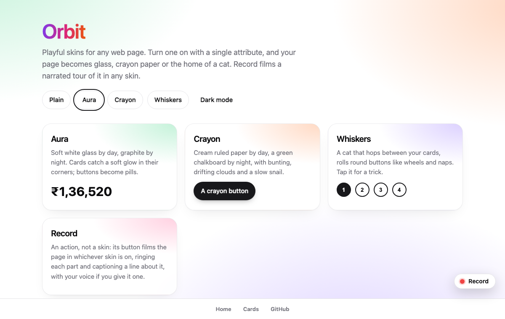
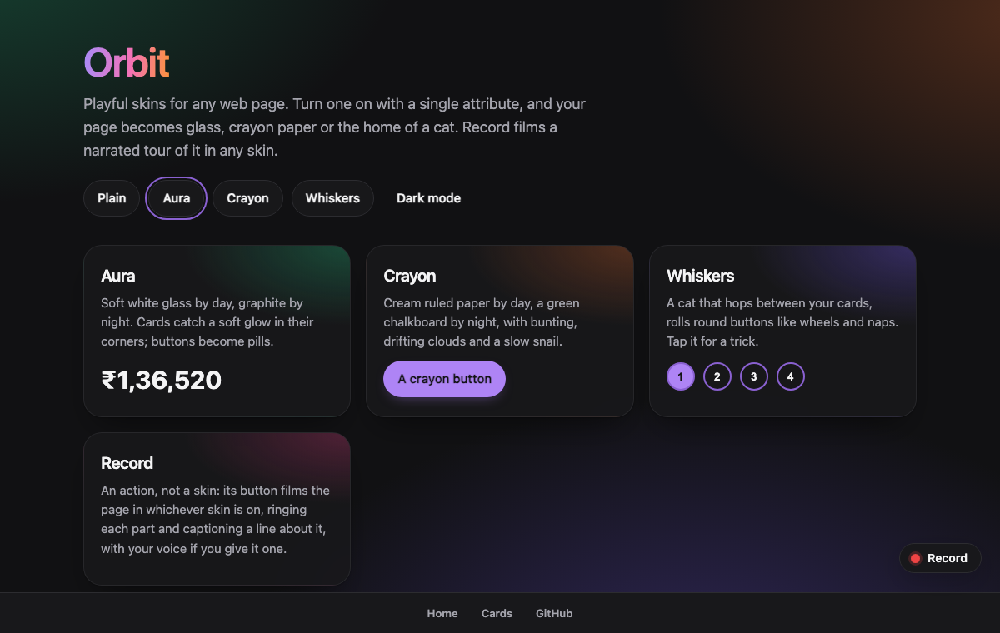
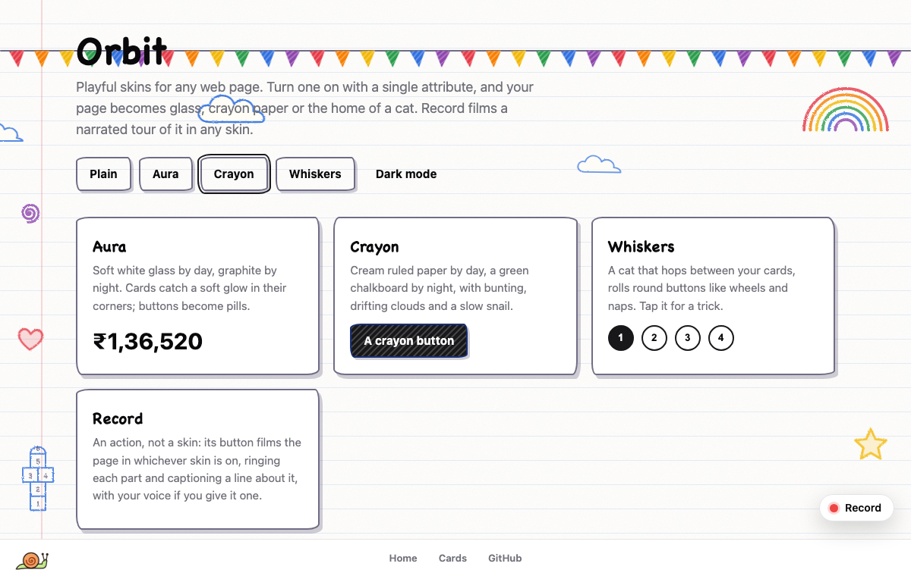
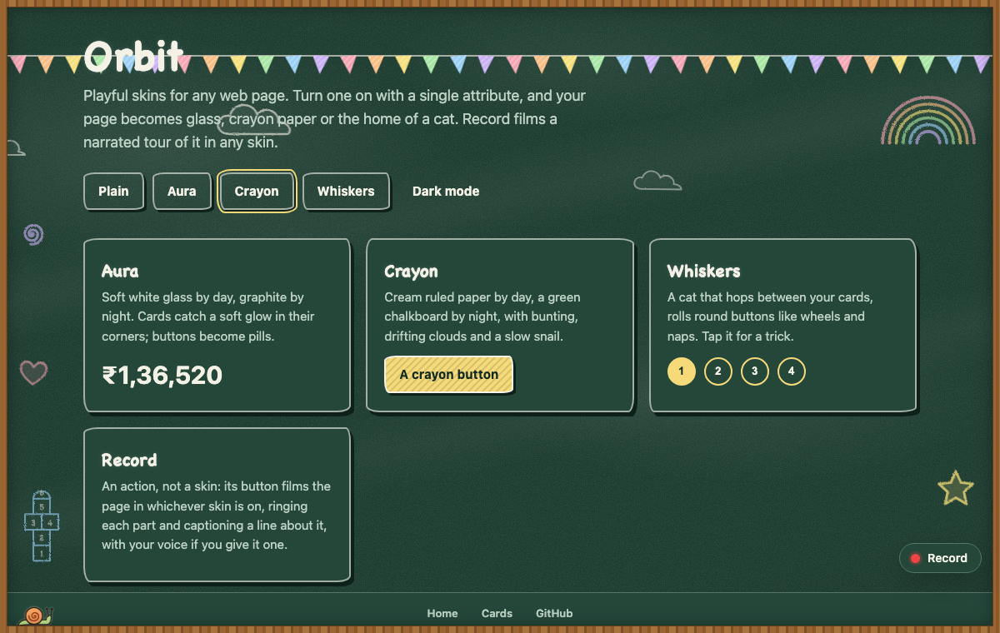
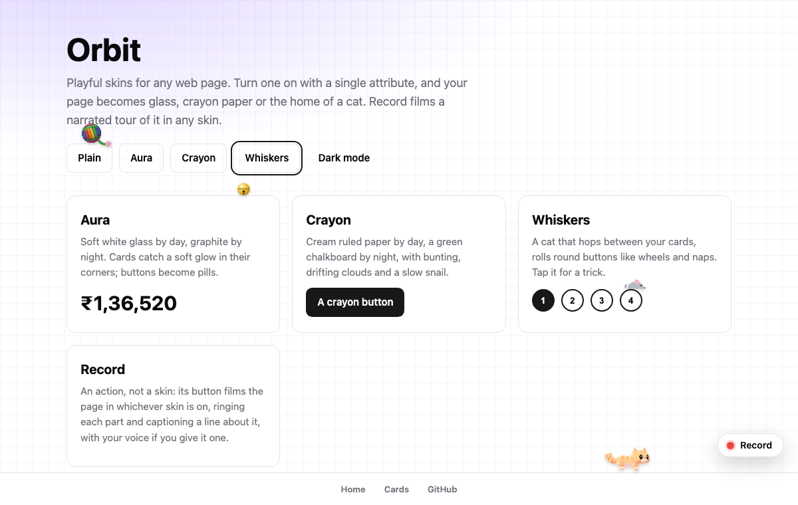
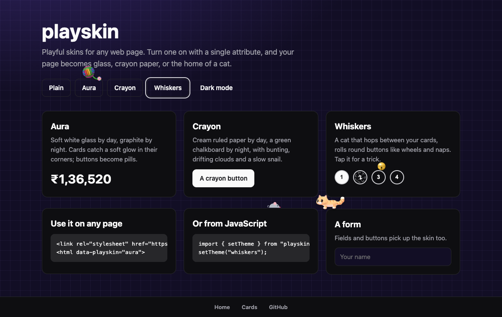

# playskin

Playful skins for any web page. Turn one on with a single attribute, and your page becomes soft glass, crayon paper, the home of a cat, or a narrated tour you can film.

| Skin | What it does |
|---|---|
| **Aura** | Soft white glass by day, graphite by night. Cards catch a soft glow in their corners, buttons become pills, page titles get a violet-to-pink wash. |
| **Crayon** | Cream ruled paper by day, a green chalkboard in a wooden frame by night. Hand-drawn borders, handwriting headings, and doodles behind the page: bunting, drifting clouds, a rainbow and a slow snail. |
| **Whiskers** | A cat that lives in the whole window. It hops between your cards under real physics, rolls round buttons like wheels, chases a ball of yarn, naps, gets hungry and asks to be fed. Tap it for a trick; double-tap for its trick panel. |
| **Record** | Keeps your page's look and adds a Record button. It films the tab while it scrolls to each part of the page, rings it, captions a line about it and plays a voice for it, then downloads the video. Each page brings its own script. |

Aura, Crayon and Whiskers follow light and dark mode (a `dark` class on `<html>`), respect `prefers-reduced-motion`, and step aside in forced-colors mode.

## Screenshots

The same demo page in each skin, light on the left and dark on the right.

### Aura

<p>
  
  
</p>

### Crayon

<p>
  
  
</p>

### Whiskers

<p>
  
  
</p>

## Try it

Open `index.html` from this repository in a browser (`npm run demo` serves it), or see the live demo once GitHub Pages is on.

## Use it on any page

No build step is needed. Add the stylesheet and set the attribute:

```html
<link rel="stylesheet" href="https://cdn.jsdelivr.net/npm/playskin/themes/aura.css">
<html data-playskin="aura">
```

Crayon's doodles and the Whiskers cat need a little JavaScript, which `createPlayskin` runs for you:

```html
<link rel="stylesheet" href="https://cdn.jsdelivr.net/npm/playskin/themes/crayon.css">
<link rel="stylesheet" href="https://cdn.jsdelivr.net/npm/playskin/themes/whiskers.css">
<script type="module">
  import { createPlayskin } from "https://cdn.jsdelivr.net/npm/playskin/src/index.js";
  const skin = createPlayskin();   // applies the visitor's saved skin
  skin.set("whiskers");            // or "aura", "crayon", or null for your own look
</script>
```

## Use it with npm

```bash
npm install playskin
```

```js
import "playskin/aura.css";
import "playskin/crayon.css";
import "playskin/whiskers.css";
import { setTheme } from "playskin";

setTheme("crayon");
```

### React and Next.js

```jsx
import { usePlayskin } from "playskin/react";

export function SkinPicker() {
  const [skin, setSkin] = usePlayskin();
  return (
    <select value={skin ?? ""} onChange={(e) => setSkin(e.target.value || null)}>
      <option value="">Plain</option>
      <option value="aura">Aura</option>
      <option value="crayon">Crayon</option>
      <option value="whiskers">Whiskers</option>
    </select>
  );
}
```

### Record a narrated tour

Give Record a script for the page you are on. Each step names a heading on the page (or a CSS selector as `target`) and the line to say. `voice` is optional: return audio for a line, from any text-to-speech you run, and it goes into the video. Without it the lines show as captions.

```js
import "playskin/record.css";
import { createPlayskin } from "playskin";

const scripts = {
  home: { title: "Home tour", steps: [
    { heading: "Dashboard", say: "This is the dashboard. It shows today's orders." },
    { heading: "Revenue", say: "Revenue is the sum of paid orders this month." },
    { heading: "Settings", press: '[data-tab="settings"][aria-pressed="false"]', say: "Settings hold the rules." },
  ]},
};
createPlayskin({ record: {
  script: () => scripts[location.pathname.slice(1) || "home"] || null,
  intro: [{ target: ".logo", say: "Acme helps shops sell online." }],
  voice: async (text) => (await fetch("/tts", { method: "POST", body: text })).arrayBuffer(),
}}).set("record");
```

A step's `press` clicks a control before its line, and the tour presses it back at the end. Chrome and Edge record the tab; the browser asks once to share it. Esc stops early.

`<PlayskinRoot />` applies the saved skin without any picker. To avoid a flash of the plain look on load, put the output of `bootScript()` in an inline `<script>` in `<head>`.

## How your page is read

The skins repaint the colour variables that Tailwind and shadcn/ui sites already use: `--background`, `--foreground`, `--card`, `--primary`, `--muted`, `--border`, `--ring` and the rest, each an HSL triple such as `240 10% 4%`. A site built that way changes colour everywhere with no other work. Any other site can define the same variables.

A few markers let a skin restyle specific parts:

| Marker | Used for |
|---|---|
| `data-card` | Cards: glass in Aura, hand-drawn in Crayon, platforms for the cat |
| `data-card-title` | Card titles |
| `data-button="default"`, `"outline"`, `"secondary"`, `"ghost"`, `"destructive"`, `"link"` | Buttons and their variants |
| `data-topbar` | The top bar: frosted glass in Aura; a rainbow edge and bunting in Crayon |
| `data-brand` | Your logo link, where Crayon's paper plane takes off |
| `data-wordmark` | Your name in the top bar: tight in Aura; each letter its own crayon colour in Crayon |
| `data-nav` | A row of nav links; mark the current one with `aria-current="page"`. Each icon gets its own colour and the current one a pill in Aura; hand-written and circled in Crayon |
| `data-theme-toggle` | Your light and dark button; Crayon swaps its face for a sun and a moon |
| `data-playskin-floor` | An element whose top edge is the cat's floor, such as a bottom tab bar |
| `data-playskin-ignore` | Anything the cat should never walk on |
| `data-cat-chart` | Charts the cat plays with |

Dark mode follows `class="dark"` or `data-theme="dark"` on `<html>`, whichever your app uses.

Headings, `main`, form fields, menus (`role="menu"`, `role="listbox"`) and tabs (`role="tab"`) are styled with no markers.

## API

### `createPlayskin(options)`

Keeps the attribute on `<html>` in step with the chosen skin and runs each skin's effects. Returns `{ get, set, subscribe, destroy }`.

| Option | Default | Meaning |
|---|---|---|
| `themes` | `["aura", "crayon", "whiskers", "record"]` | Skins that may be turned on |
| `storageKey` | `"playskin"` | `localStorage` key for the visitor's choice; `null` to not save it |
| `attribute` | `"data-playskin"` | Attribute set on the root element |
| `root` | `document.documentElement` | Element that carries the attribute |
| `effects` | `true` | Set `false` to run Crayon's drawings and the cat yourself |
| `crayon` | `{}` | Options passed to `startCrayon` |
| `whiskers` | `{}` | Options passed to `startWhiskers` |
| `record` | `null` | Options passed to `startRecord`; Record shows nothing without a script |

`setTheme(name)` and `getTheme()` do the same with the default options. `bootScript(options)` returns the no-flash script text.

### `startWhiskers(options)` from `playskin/whiskers`

Brings out the cat. It shows while `show()` returns true (by default, while the skin is `"whiskers"`) and leaves when it returns false. Options: `floor` and `ignore` (CSS selectors), `storage` (prefix for its saved name and hunger, default `"playskin.cat"`), `global` (window property for its controls, default `"playskinCat"`), `meow` (URL of its meow recording), `music` (an object whose `on` is true while page music plays), `reducedMotion` (a function).

An app can make the cat its own:

| Option | Default | What it does |
|---|---|---|
| `scenes` | `[]` | Functions that each return a scene for the current page (its ledges, boxes and floor) or null. The first that answers is used. |
| `room` | `true` | Play in the whole window when no scene answers. Set `false` to keep the cat to your scenes. |
| `pet` | `true` | Give it a name and hunger, and a food bowl in its panel. |
| `label` | | What screen readers hear for the cat. |
| `jokes` | built in | The lines it says when tapped. |
| `aloud` | `false` | Speak its lines while `music.on` is true. |
| `slide` | `false` | Shoved boxes slide sideways and settle back, instead of only bumping up. |
| `follow` | `false` | Scroll the cat back into view when it leaves the window. |
| `game` | `null` | A game module (rules, foes, levels) for the cat to play. |
| `line`, `read`, `home` | | Where its speech bubble points, the text it reads out, and its home spot. |

`playskin/whiskers/physics` holds the cat's physics on its own, for games and tests.

### `startRecord(options)` from `playskin/record`

Adds the Record button. It shows while `show()` returns true (by default, while the skin is `"record"`) and the page has a script. Options: `script` (a function returning `{ title, steps }` for the current page, or null), `intro` (steps that lead every script), `voice` (async text to an `ArrayBuffer` of audio), `headings` (where heading steps look, default `main h1, main h2, main h3`), `sectionOf` (the part to ring for a heading), `offset` (pixels left above a part when scrolling to it), `label`, and `onMessage(text, tone)`. Returns `{ refresh, start, stop, running, destroy }`; call `refresh()` after the page changes. Colours come from `--playskin-record-accent`, `-surface`, `-ink` and `-line`, or the variables above.

### `mountCrayonDoodles(target)` from `playskin/crayon-doodles`

Adds Crayon's doodles to `target` (default `document.body`) and returns a function that removes them. `crayon.css` shows them only while the Crayon skin is on.

### `startCrayon(options)` from `playskin/crayon`

Brings out all of Crayon on the marked parts: the corner doodles and snail, bunting under `data-topbar`, a letter for each crayon colour in `data-wordmark`, the sun and moon in `data-theme-toggle`, and the paper plane. `createPlayskin` runs it while the skin is `"crayon"`, so most apps never call it. If your app redraws those parts, it adds them again on the next frame. Options: `anchor` (where the plane takes off), `reducedMotion`, `doodles` and `plane` (set `false` to leave one out). Returns `{ fly, flights, stop }`; `stop()` takes every part away and gives the wordmark back its plain text.

### Crayon's drawings from `playskin/crayon`

The same drawings, for an app that wants to place them itself. `crayon.css` styles them in light and dark.

| Export | What it is |
| --- | --- |
| `PLANE_SVG` | A folded paper plane facing right |
| `CRAYON_TOGGLE` | A light and dark button face: a smiling sun in light, a moon with stars in dark |
| `CRAYON_ICON` | A red crayon, for a style menu |
| `BUNTING` | A string of flags that hangs below a top bar |
| `LADYBUG_SVG` | A ladybug facing up |
| `SNAIL_SVG` | A snail; inside an element with the `cr-snail` class it crawls the width of the page and back |
| `planeFrames({ cx, cy }, width)` | Keyframes for one flight: a climb, a loop-the-loop and a glide off the right edge |
| `startCrayonPlane(options)` | Sends the plane off your brand every 14 to 26 seconds |

`startCrayonPlane` options: `anchor` (the element it takes off from, default `[data-brand]`), `active` (whether it may fly, default while the Crayon skin is on), `reducedMotion`, `every` and `first` (milliseconds between flights and before the first, as `[shortest, longest]`). It never flies under reduced motion or in a hidden tab, and returns `{ fly, flights, stop }`; `fly()` sends it now.

## Credits

The cat's meow is a public domain (CC0) recording from the "Micro Pack - Cat Meows" sound pack. Everything else is original work.

## Licence

[MIT](LICENSE)
